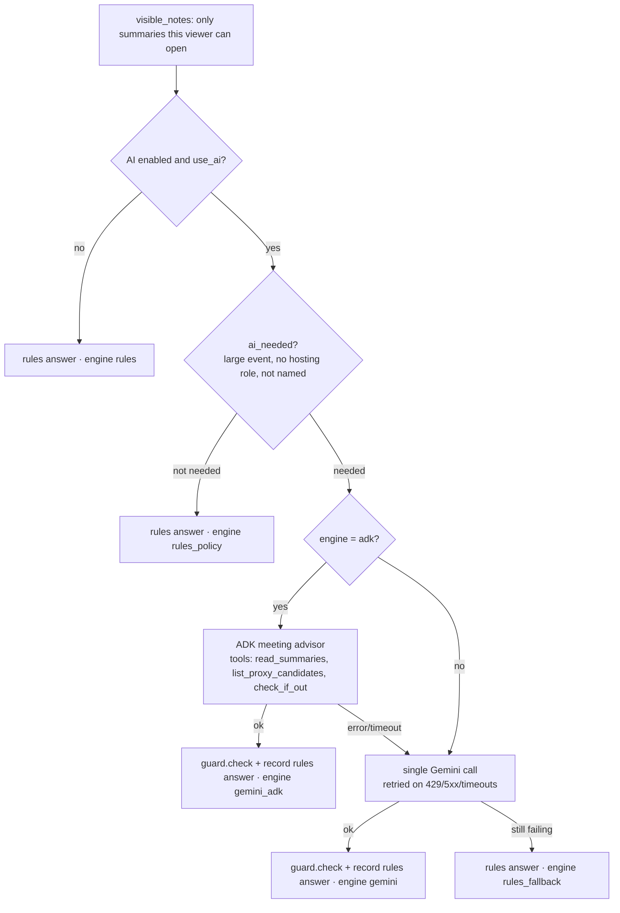

# Recommendation pipeline

`agents/orchestrator.analyze(event, absent, viewer_id, people, calendar, is_out, use_ai)` is the **one entry point**. It is called only from `Service._analyze`. It takes one affected meeting and one viewer and returns `(ItemKind, AiResult)`, the card's AI block.

**The AI can never block or break the app.** Every failure falls through to a cheaper path, and the card says which path answered.

## Flow

1. **Privacy filter first.** `calendar.visible_notes(event, viewer_id)` keeps only the summaries this viewer may open. Nothing else is read. See [Privacy rule](privacy-rule.md).
2. **AI off** (`[ai] enabled = false`, as in the tests) or `use_ai=False` (card creation): return the rules answer from `agents/fallback/rules_recommender.recommend`.
3. **Large-event policy** (`ai_needed`): for a large event where the absent person has no hosting role and is not named, the rules answer with engine `rules_policy` and no AI cost. With `[ai] large_event_ai_when_named`, the AI still looks if the person is named.
4. **ADK agent** (`[ai] engine = "adk"`): it runs once, because it already makes several calls, and it retries each step itself (`agent_step_attempts`). The whole loop is limited by `adk_timeout_seconds` (45). On any error the reason is noted ("the ADK agent didn't answer in time" / "wasn't available") and the next step runs. See [ADK advisor](adk-advisor.md).
5. **Single Gemini call** (`agents/recommender_ai.recommend_ai`): everything is in one prompt, with structured output (`Recommendation` schema). `_with_retries` makes `[ai] attempts` (3) tries with waits of `retry_wait_seconds` ([1, 3]), but only for temporary errors: status codes in `retry_status_codes` [429, 500, 502, 503, 504], any 5xx, or errors with no code such as timeouts. Other 4xx errors are our own mistakes and are not retried.
6. **Rules fallback**: if the single call still fails and `[ai] fall_back_to_rules`, the rules answer with engine `rules_fallback` and the check "the AI was unavailable…".
7. **Guard + rules answer** (the `check()` wrapper) runs on every AI answer:
   - `agents/guard.check` applies the [12 plain-code rules](guard.md);
   - then the rules run once more to fill `AiResult.rulesAnswer` (kind, recommendation, suggested proxy, reason). That is "what simple rules would have said", shown as **"AI changed the answer"** when it differs.

## Engine values (`AiResult.engine`)

| Engine | Set by | Card label (web) |
|---|---|---|
| `gemini_adk` | ADK agent answered | "Gemini · ADK agent" |
| `gemini` | Single Gemini call answered | "Gemini" |
| `rules` | AI switched off | "Rule-based" |
| `rules_policy` | Large event the rules handle, so no AI is needed | "Rule-based · large event" |
| `rules_fallback` | AI unavailable, or analysis taking more than 60 s | "Rule-based · AI unavailable" |
| `rules_override` | Guard rule 4 replaced the AI's answer (it recommended `attend`) | "Rule-based · AI answer not allowed" |
| `analysing` | Placeholder while background analysis runs | "AI analyzing…" |
| `mixed` | Organizer card whose absentees came from different engines | "Gemini and rules" |

If the guard made any correction, the card adds "Adjusted by rules" and lists each one in `AiResult.checks`.

## What the model is told and shown

- **Instructions** (`recommender_ai.INSTRUCTIONS`, shared by the agent):
  - pick a kind;
  - read **who gives and who receives** (a KT *from* the absent person → reschedule);
  - **prefer a proxy** when someone can carry the absent person's item, and **never guess**;
  - recommend reschedule only when the input says the meeting cannot work without them; cancel rarely; never `attend`;
  - a confidence rubric;
  - plus the untrusted-text rule ([Prompt-injection defence](prompt-injection-defence.md)).
- **Prompt** (`build_prompt`):
  - the person on leave, the title, the agenda wrapped in `<invite_text>`, the organizer, the group-list flag;
  - visible summaries wrapped in `<summaries>`;
  - the invitee **count**;
  - at most `[ai] max_candidates` (20) candidate proxies, as `id | name | title | relation`. People out that day are never offered.
- **Facts filled in by code, not the AI**: `sources`, `summariesAvailable`, `fingerprint` and `model` (`to_ai_result`).
- **Settings**: `temperature = 0` (the same meeting gets the same answer), `thinking_budget = 0`, `timeout_seconds = 20`. The library's own retries are off (`HttpRetryOptions(attempts=1)`); the orchestrator owns retrying.

## Caching and background analysis

The orchestrator is pure. Caching, background threads, the "AI analysing…" label, and raising an auto-handled card are handled by `Service`. See [Analysis cache](analysis-cache.md).

## Related
- [ADK advisor](adk-advisor.md)
- [Guard](guard.md)
- [Rule-based fallback](rule-based-fallback.md)
- [AI settings](../config/ai-settings.md)
