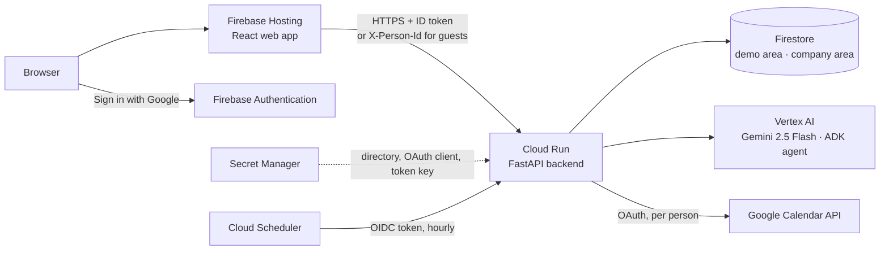

# System overview

Close the Gap has two parts:
- a **React + Vite** single-page app, served by **Firebase Hosting**;
- a **FastAPI** backend on **Cloud Run** (Python 3.13).

The backend stores data in **Firestore** and asks **Gemini 2.5 Flash on Vertex AI** (region `asia-south1`) through an **ADK agent**. Signed-in people use **Firebase Authentication** (Google sign-in) and can connect their own **Google Calendar**. Secrets live in **Secret Manager**.

## Components

| Component | Role | Details |
|---|---|---|
| Web app (`web/`) | Four tabs: Attendee Mode, Organizer Mode, Proxy Requests, Past. Polls the backend | [Frontend architecture](frontend-architecture.md), [Frontend UI](frontend-ui.md) |
| Firebase Hosting | Serves `web/dist`, with SPA rewrites and security headers | [Deployment](../operations/deployment.md) |
| Firebase Authentication | Google sign-in. The backend verifies the ID token on every request | [Auth and access](auth-and-access.md) |
| Cloud Run backend (`backend/`) | All business logic. **One instance**, CPU always on, concurrency 20 | [Backend layers](backend-layers.md) |
| Firestore | Both areas in shared collections, isolated by `workspaceId` | [Storage](storage.md) |
| Vertex AI (Gemini) | The ADK meeting advisor, the single-call recommender, the handover brief. No API key; uses service-account or ADC credentials | [Recommendation pipeline](recommendation-pipeline.md) |
| Google Calendar API | Per-person OAuth (company area only): import, create, move, cancel, add attendee | [Google integrations](google-integrations.md) |
| Secret Manager | `COMPANY_DIRECTORY`, OAuth client id and secret, Fernet token-encryption key | [Environment variables](../config/environment-variables.md) |
| Cloud Scheduler | Calls `POST /jobs/run-reminders` hourly with an OIDC token | [Reminder job](../operations/reminder-job.md) |

## Why one warm instance

- Background AI analysis runs in a thread pool **inside the process**, so it must keep running between requests (`--no-cpu-throttling`).
- The AI answer cache, the email outbox and the rate-limit counters live **in memory**. Several instances would each have their own copy.
- Each request reads each Firestore collection at most once (the [request read cache](storage.md#per-request-read-cache)). This keeps a page at about 1 s, and about 3 s with four visitors at once.

A shared cache (for example Memorystore) and multiple instances are listed as [future scope](../overview/limits-and-future-scope.md).

## The AI never blocks or breaks the app

- Pages answer at once with the rule-based suggestion, labelled "AI analysing…".
- The AI fills in the answer in the background ([Analysis cache](analysis-cache.md)).
- If the agent fails, a single Gemini call answers. If that fails too, the rules answer and say so ([Recommendation pipeline](recommendation-pipeline.md)).

## Related
- [Backend layers](backend-layers.md)
- [Areas](../concepts/areas.md)
- [Deployment](../operations/deployment.md)
