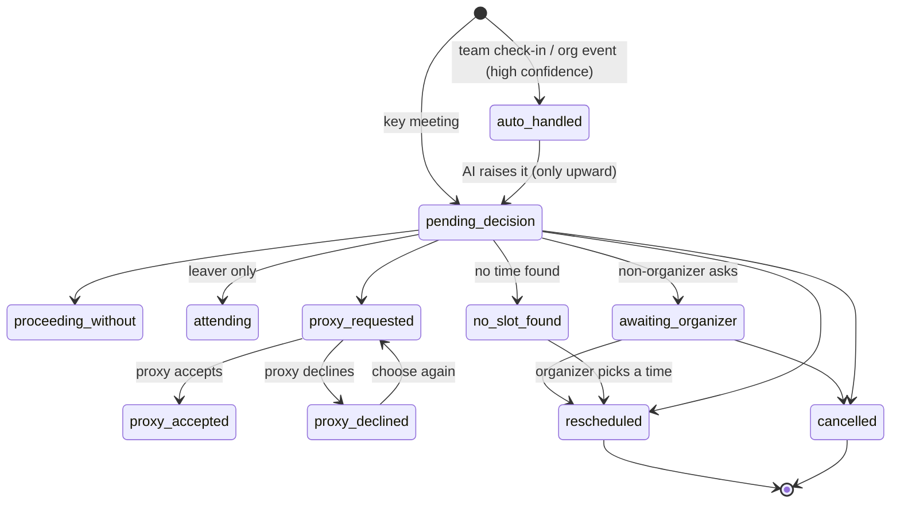

# Meeting card (`MeetingItem`)

A **card** is the unit of work. There is exactly one per *(affected meeting, absent person)*. A meeting with two people out has two cards. Organizer Mode groups them into one `OrganizerMeeting` per meeting.

A card holds:
- a snapshot of the meeting (`EventRef`),
- its [kind](meeting-kinds.md),
- the AI's recommendation (`AiResult`),
- the lifecycle `status`,
- what was decided, by whom, and what the decider was shown at the time.

## Stored fields

| Field | Meaning |
|---|---|
| `id` | `i_…` |
| `absenceId`, `absentPersonId` | The absence that created it, and who is out |
| `ownerRole` | `leaver` (planned absence) or `organizer` (sudden). See [Absence](absence.md) |
| `event` | `EventRef`: `calendarEventId`, `instanceStart`, `title`, `start`, `end`, `organizerId`, `attendees` |
| `kind` | `key_meeting`, `team_checkin` or `org_event` |
| `ai` | `AiResult` (recommendation, reason, confidence, sources, proxies, engine, checks, tools used, rules answer…) |
| `status` | One of the 11 statuses below |
| `chosenAction`, `chosenProxyId` | What was chosen |
| `originalStart`, `rescheduledTo` | Set when the meeting was moved |
| `recommendedWhenDecided`, `aiWhenDecided` | What the decider saw. Feeds "recommendations followed" and the read-only Past view |
| `declinedProxyIds` | Who declined to cover, in order (filled in when the card is viewed) |
| `decidedBy` | Person id, or `"system"` (for example cancelled in Google Calendar) |
| `organizerAlerted` | The organizer was already emailed, so the under-24-hour alert is not repeated |
| `createdAt`, `updatedAt` | Timestamps |

These fields are **computed per viewer** at list time and never stored (`Service._view`):
- `needsAttention`
- `urgency`
- `hoursToStart`
- `ai`, which is recomputed for this viewer from the summaries they can open

## Statuses (`ItemStatus`)

| Status | Meaning | Needs attention? |
|---|---|---|
| `pending_decision` | Created and nobody has decided | yes |
| `auto_handled` | Routine meeting; going on without the person automatically | no ("No action needed") |
| `attending` | The absent person will attend anyway | no |
| `proceeding_without` | Go on without them | no |
| `proxy_requested` | A proxy was asked and has not answered yet | yes |
| `proxy_accepted` | The proxy accepted | no |
| `proxy_declined` | The proxy declined; choose again | yes |
| `awaiting_organizer` | A non-organizer asked for reschedule or cancel | yes |
| `no_slot_found` | Reschedule was tried and no time works; the organizer picks one | yes |
| `rescheduled` | **Terminal**: moved to `rescheduledTo` | no |
| `cancelled` | **Terminal**: this occurrence was cancelled | no |

- `ATTENTION` (in `service.py`) is the set marked "yes" above.
- `TERMINAL = {rescheduled, cancelled}`. A terminal card cannot be changed any more (`apply_action` raises).
- A card is **past** once `event.end <= now`. It then leaves the working tabs and appears in **Past** for `[visibility] past_days` (30).

## The three groups in each tab

| Group | Rule (web app) |
|---|---|
| **Needs action** | `needsAttention` is true |
| **Settled** | Not `needsAttention` and status ≠ `auto_handled`: a person decided |
| **No action needed** | `auto_handled`: handled automatically, and anyone can still change it |

The backend's `attendee_items` returns `needsAction` plus `noActionNeeded.{teamCheckins, orgEvents, rescheduledOrCancelled}`. The web app re-groups these into the three groups above.

## Urgency

Urgency is set only while a card needs attention, and is the same for every viewer (`_view`):
- `urgent` (red, "act now") when the meeting starts within `[urgency] urgent_hours` (24).
- `soon` (amber) within `[urgency] soon_hours` (48).
- Further out the web app shows "In N days" in green.

An organizer card takes the most severe urgency of its open absentees.

## Lifecycle at a glance

Any non-terminal status can move to any action's result. A person can change their mind until the card is rescheduled or cancelled. See [Decide on a card](../flows/decide-on-a-card.md).

## Related
- [Actions](actions.md)
- [Meeting kinds](meeting-kinds.md)
- [Data models](../api/data-models.md)
