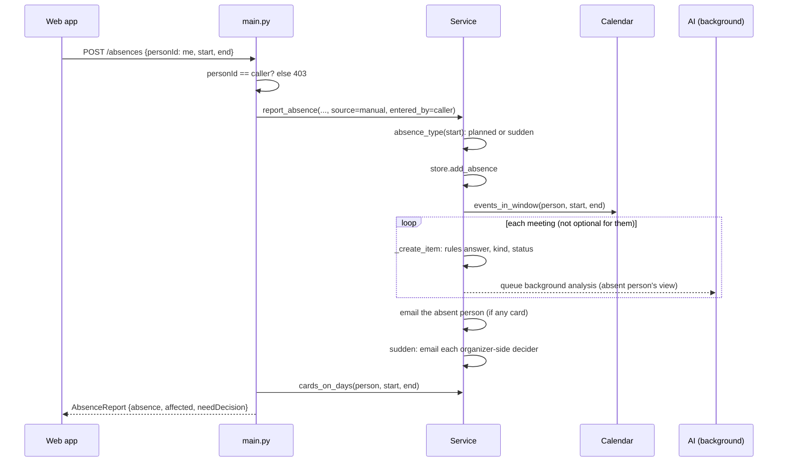

# Flow: report an absence

## Steps

1. **The form** (`AddAbsence` in `App.jsx`) shows "Who is out" read-only as yourself, and dates default to today+14 and today+15. It notes that an absence starting within `suddenNoticeHours` counts as sudden.
2. **`POST /absences`** with body `{personId, start, end}`. The backend refuses anyone but the caller (403), in both areas.
3. **`Service.report_absence`**:
   - checks the person exists and that `end >= start`;
   - derives `type` ([planned or sudden](../concepts/absence.md));
   - saves an `Absence` (`a_…`).
4. **`_scan(absence)`**, for each meeting from `calendar.events_in_window`: the person is the organizer or an attendee, the meeting is not cancelled, and its start date (UTC) is within the range.
   - Skip it if the person is only **optional** (`is_invited_as_optional`).
   - **`_create_item`** skips meetings that have already ended and cards that already exist for *(meeting, person)*. That is how overlapping absences avoid duplicates.
     - `ownerRole` is `leaver` (planned) or `organizer` (sudden).
     - The card starts as `key_meeting` / `pending_decision`, and is then classified **with the rules only** (`analyse_on_creation = false`) from the absent person's view.
     - A routine kind becomes `auto_handled` with `proceed_without`.
     - The event is logged as `item_created`.
     - The AI analysis is **queued in the background**. It never delays the response, and it may later [raise](../concepts/meeting-kinds.md) the card.
5. **Emails** (see [Notifications](../architecture/notifications-and-reminders.md)):
   - If any card was created, the absent person gets "You're out {when}: N meetings need a decision". If nothing is affected, no email is sent.
   - **Sudden absence**: each organizer-side decider of the cards that need a decision gets "{name} is out suddenly…", and those cards are marked `organizerAlerted`.
   - **Planned leave**: organizers get no email now. They see the cards in Organizer Mode, and get the under-24-hour alert if nobody acts.
6. **Response** (`AbsenceReport`):
   - `affected` is the number of the person's upcoming cards on those days, including cards created by earlier overlapping absences;
   - `needDecision` is how many of them are `pending_decision`.
7. **The web app** shows "Absence saved: you are out {span}. N meetings are affected, K need a decision." and refreshes.

The demo-only `POST /dev/simulate-leave-system` does the same with `source = leave_system`, for any demo person.

## Related
- [Absence](../concepts/absence.md)
- [Meeting card](../concepts/meeting-card.md)
- [Analysis cache](../architecture/analysis-cache.md)
